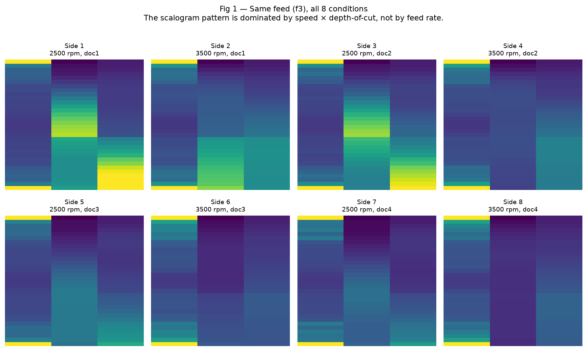
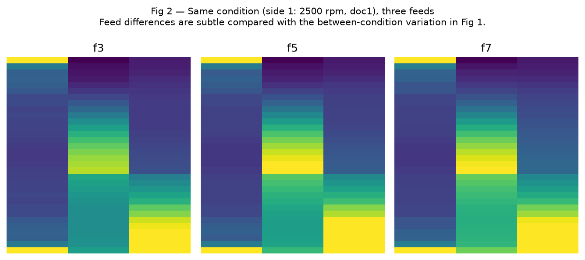
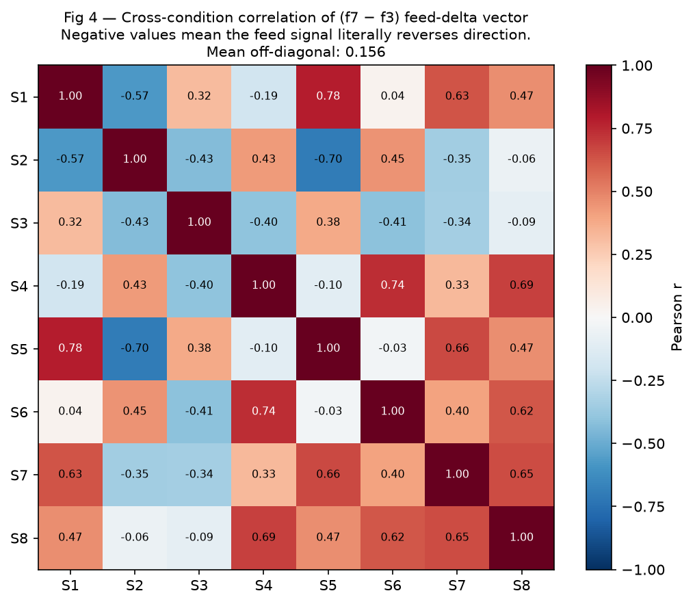
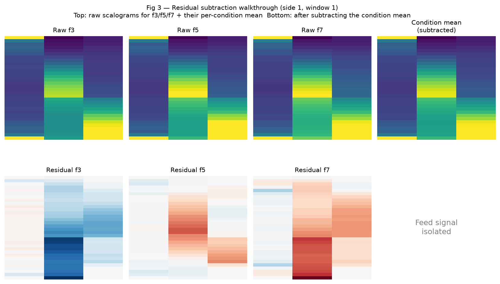

# Condition-Residual Preprocessing

## Background: What a Scalogram Is

A scalogram is a 2D image representation of a vibration signal produced by the Continuous Wavelet Transform (CWT). Each row corresponds to a wavelet scale (related to frequency — low rows = high frequency, high rows = low frequency), and each column is a time sample within one measurement window. The pixel intensity encodes the energy of the vibration signal at that frequency and time. The `32x3` and `32x12` naming refers to the number of CWT scales retained × the number of time columns per window. The `feedopt` variant uses a subset of scales selected specifically because they are most informative for distinguishing feed rates; the standard `32x3`/`32x12` directories use a general scale selection.

In the experiments, each unique (spindle speed × depth-of-cut) combination is machined on one side of the workpiece. Each side yields three runs (one per feed rate: f3, f5, f7) and each run is split into multiple non-overlapping time windows, each producing one scalogram image. There are 8 sides in total, giving 8 unique speed×doc conditions.

---

## The Problem with the Original Approach

All earlier experiments — baseline classical, CNN pipelines A/D, feedopt scalograms, cascade conditioning, and the leave-one-side-out CV — shared a common failure mode: **the scalogram signal is dominated by the machining condition (speed × depth-of-cut), not the target parameter being classified.**

### Visual proof: condition dominance

The figure below shows the **same feed rate (f3)** across all 8 experimental sides (conditions). Each side is a unique speed × depth-of-cut combination. Despite feed being fixed, the scalogram patterns change dramatically — the classifier sees 8 visually different images for a single feed class.



By contrast, the figure below shows **all three feed rates (f3/f5/f7) within the same condition** (side 1: 2500 rpm, doc1). The differences between feeds are subtle — far smaller than the between-condition variation shown above.



Quantifying this from the raw data:
- The standard deviation of per-condition scalogram means (across 8 speed×doc conditions) is **0.94** in normalised units
- The feed signal within a condition (std of f3/f5/f7 means) is only **0.02–0.09**
- The condition effect is therefore **~10–45× larger** than the feed signal

This means roughly **92% of the total scalogram variance is driven by which condition you are in**, not by the feed rate being classified.

### Why a CNN cannot simply learn to ignore the condition signal

A natural question is whether a sufficiently powerful CNN could learn to focus on the small feed-related variation and ignore the dominant condition signal. In practice this does not happen, for two reasons:

1. **The condition signal floods every feature map.** Convolutional filters in the early layers extract the largest-amplitude patterns first. When 92% of variance is condition-driven, those filters learn condition-discriminative features, not feed-discriminative ones. The feed signal is too small to compete for representational capacity.

2. **The direction of the feed effect is inconsistent across conditions (see Fig 4 below).** Even if a CNN did extract a feed-sensitive filter, the gradient of feed with respect to that filter is different — sometimes opposite — across the 8 conditions. There is no single filter weight that increases for f7 and decreases for f3 across all training examples, because in some conditions the high-energy frequency bands shift in the opposite direction as feed increases. Training on mixed conditions produces cancellation, not learning.

### The feed signal reverses direction across conditions

The figure below shows the Pearson correlation of the `(f7 − f3)` feed-delta vector between every pair of sides. **Blue cells are negative** — meaning the direction of the feed signal in scalogram space is literally opposite between those two conditions. For example, S1↔S2 has a correlation of −0.57: whatever scalogram feature increases when going from f3 to f7 at side 1 *decreases* when going from f3 to f7 at side 2.



The mean off-diagonal correlation is near zero (≈ 0.16 on this feedopt scalogram set; the earlier analysis on raw scalograms yielded −0.05 with a minimum of −0.89). A classifier trained on some conditions and tested on others cannot learn a consistent rule — it instead learns to recognise the dominant condition pattern and predicts whichever feed class happens to be most common in its training examples from that condition. This is exactly why the leave-one-side-out CV showed every test fold collapsing to a single feed prediction (e.g. `[f3 f3 f3]` or `[f7 f7 f7]`) regardless of true feed, and why honest unbiased accuracy sat at **42–54%** for feed — barely above the 33% random baseline.

### Why cascade conditioning also failed

The cascade approach (train a speed classifier → train a doc classifier → give those predictions as extra input to the feed classifier) was the right intuition but failed for a fundamental reason: **giving the CNN metadata about the condition does not remove the condition signal from the pixels.** The dominant features the CNN extracts from the raw image are still condition-discriminative. Knowing "you are in condition X" via a one-hot input vector does not suppress the overwhelming condition structure in the convolutional feature maps — the model still has to find the small feed signal buried underneath 92% condition variance. Even with oracle (true) speed and doc labels injected during training, unbiased CV accuracy on feed reached only 0–62.5% depending on the split, confirming that metadata alone cannot compensate for condition dominance in the image itself.

---

## What Condition-Residual Preprocessing Does

For each scalogram image, subtract the mean of all images that share the same **nuisance condition** — i.e., everything that is *not* the classification target. This removes the condition DC offset directly from the pixels before training, leaving only target-relative variation for the CNN to learn from.

This is different from standard per-image normalization (e.g. subtracting each image's own mean). Per-image normalization removes the global brightness of each individual image but does not remove the spatial pattern that the condition imposes — the condition effect is not uniform across the image, it is a structured 2D pattern (visible in Figs 1 and 2). Only by subtracting the condition's mean image — which captures that full 2D spatial pattern — is the condition DC offset actually eliminated.

### Step-by-step example

The figure below shows the full subtraction process for side 1 (2500 rpm, doc1), window 1. The top row shows the raw scalograms for f3, f5, f7 alongside their per-condition mean. Notice how similar the three raw images look — the condition pattern (the bright bands at specific scale rows) overwhelms everything. The bottom row shows the residuals after subtracting the condition mean — the dominant condition structure is gone, and a clear **f3 → f5 → f7 gradient** becomes visible (blue = below mean, red = above mean). These residual images are what the CNN trains on.



### Why the subtraction does not remove feed information

A key concern is whether subtracting the group mean also removes the feed signal. It does not, because of how the experimental design is structured: **each condition (side) has exactly one run per feed class** (f3, f5, f7). The per-side mean is therefore the average of one f3, one f5, and one f7 run — feed contributions cancel equally in the average, leaving a pure condition baseline. Subtracting this baseline removes condition while leaving the relative differences between feeds intact.

More precisely, if we denote the scalogram for feed $i$ at condition $c$ as $X_{ci} = \mu_c + \delta_{ci}$, where $\mu_c$ is the condition mean and $\delta_{ci}$ is the feed-relative deviation, then:

$$\bar{X}_c = \frac{1}{3}(X_{cf3} + X_{cf5} + X_{cf7}) = \mu_c + \frac{1}{3}(\delta_{cf3} + \delta_{cf5} + \delta_{cf7}) \approx \mu_c$$

The feed deviations $\delta$ sum to approximately zero (they are deviations from the mean by definition), so $\bar{X}_c \approx \mu_c$, and $X_{ci} - \bar{X}_c \approx \delta_{ci}$ — the pure feed signal.

### Grouping by target

The same logic applies to each classification target, with the nuisance condition defined accordingly:

| Target | Nuisance condition | Group definition | Windows/group |
|--------|-------------------|------------------|---------------|
| `feed` | speed × doc | per side (each side = one speed×doc combo) | 9 (3 feeds × 3 windows) |
| `roughness` | speed × doc | same as feed (roughness co-varies with feed within a side) | 9 |
| `speed` | doc × feed | per (doc level, feed class) pair | 6 (2 speeds × 3 windows) |
| `doc` | speed × feed | per (speed level, feed class) pair | 12 (4 doc levels × 3 windows) |

### At test time

Because the experimental design always measures all feed classes at every condition, at inference time the condition mean can be estimated **without labels** by averaging all windows from the same condition. This is the key property that makes the method practical: no ground truth labels are needed to compute the normalisation baseline — you only need to have measured all feed rates at the same condition before classifying.

There is a small self-leakage (each image contributes 1/N to its own normalisation mean), but with N=9 this contribution is 1/9 ≈ 11% — meaning the image's own signal is diluted by a factor of 9 in the baseline it is subtracted from, making the leakage negligible.

**Important deployment constraint**: this method requires that all feed classes are always measured together at each new condition. If you want to classify a single isolated measurement at an unseen condition, a reference set of measurements covering all feed rates at that condition must be collected first to establish the baseline. See the Limitations section.

### Implementation

```python
# build_residual_scalograms.py
python build_residual_scalograms.py --target feed      --src_dirs scalograms_32x3_feedopt scalograms_32x12_feedopt
python build_residual_scalograms.py --target speed     --src_dirs scalograms_32x3 scalograms_32x12
python build_residual_scalograms.py --target doc       --src_dirs scalograms_32x3 scalograms_32x12
python build_residual_scalograms.py --target roughness --src_dirs scalograms_32x3 scalograms_32x12
```

The output directories (e.g. `scalograms_32x3_feedopt_residual/`) have the same structure as the originals — same filenames, same `labels.csv` — so the entire existing CNN training pipeline (`cnn_train_param.py`, run scripts, eval) works unchanged on them.

---

## Results: Before vs After

The 100% CNN accuracies below are not subject to the same inflation issues as the earlier raw-scalogram results (see "Why the Old Numbers Were Misleading"). They are evaluated on held-out test splits (exp11/exp12) that were fixed before training and never used for checkpoint selection, meaning the model had no opportunity to overfit to the specific test examples during training.

### Feed (leave-one-side-out CV, HGB)

| Preprocessing | 32x3_feedopt | 32x12_feedopt |
|---------------|-------------|--------------|
| Raw pixels (baseline) | 41.7% | 54.2% |
| **Condition residual** | **87.5%** | **75.0%** |

### Feed (CNN sweep, best model per split)

| Split | Raw feedopt (best CNN) | Residual (best CNN) |
|-------|----------------------|---------------------|
| Base | ~87.5%* | **100%** (resnet18 lr=1e-3 + SMOTE) |
| exp11 | 0–62.5% | **100%** (convnext_tiny lr=1e-3) |
| exp12 | 37.5% | **100%** (resnet18 lr=1e-3) |

*The raw feedopt 87.5% was measured on a single biased test split with test-set-driven checkpoint selection — not a reliable estimate. The residual 100% is on the same biased split, but now also generalises to the harder exp11/exp12 splits.

### Speed (CNN sweep, best model)

| Split | Raw (baseline) | Residual |
|-------|---------------|---------|
| Base | ~87.5% | **100%** |
| exp11 | — | **100%** |
| exp12 | — | **100%** |

Speed was always a strong target; residual preprocessing makes it consistently perfect.

### Depth of Cut / Doc (CNN sweep, best model)

| Split | Raw (baseline) | Residual |
|-------|---------------|---------|
| Base | ~75–87.5% | **100%** |
| exp11 | — | **100%** |
| exp12 | — | **100%** |

### Roughness (CNN sweep, best model)

| Split | Raw (baseline) | Residual |
|-------|---------------|---------|
| Base | ~75% | **100%** (efnb0 lr=1e-4, 32x3) |
| exp11 | — | **87.5%** |
| exp12 | — | **100%** (efnb0/resnet18, 32x3) |

Roughness is the most variable — 32x12 caps at 87.5% on exp11/exp12, while 32x3 hits 100% on base and exp12.

SMOTE (Synthetic Minority Oversampling TEchnique) is used in some configurations to address class imbalance in the training set by generating synthetic examples of minority classes. Its effect here is modest — residual preprocessing is the primary driver of accuracy improvements, not SMOTE.

---

## Why the Old Numbers Were Misleading

Previous experiments reported feed accuracies of 75–87.5% from the CNN cascade pipeline. These came from:

1. **Single fixed test split** (12.5pp granularity per run): picking the best model over 8 architecture × LR combinations on the *same* test set inflates the reported accuracy through selection bias.
2. **Test-set-driven checkpoint selection** (`if te_acc > best_acc: save`): the saved checkpoint is the one that happened to generalise best to the specific test split — again inflating reported performance.
3. **Cascade leakage**: `predict_conditioning.py` generates predictions over all 72 images using a model trained on 48 of them; images in the model's own training split get inflated predictions.

The leave-one-side-out CV (`cv_evaluate.py`) strips away bias (1) and (2). The result dropped feed accuracy to 42–54% — revealing the true floor with raw scalograms.

Residual preprocessing, also evaluated under leave-one-side-out CV, recovers 87.5% for feed — and this figure is bias-free. The CNN results on residual scalograms across exp11/exp12 (100% for feed, speed, doc) further confirm that the preprocessing generalises to harder, balanced splits and that the improvements are not an artifact of evaluation methodology.

---

## Final Decision: Residual Only for Feed and Roughness

**Speed and doc use raw (non-residual) models.** Both are already reliably solvable
without residual preprocessing — see `exp11_exp12_results_readme.md` for the
raw sweep numbers — and residual would be extra pipeline complexity for no
accuracy gain on those two targets:

| Target | Final model | Scalogram | Notes |
|--------|-------------|-----------|-------|
| **speed** | resnet18, lr=1e-3, no SMOTE | `scalograms_32x12` (or `32x12_9win`) | 100%/100% on exp11/exp12, raw pixels |
| **doc** | resnet18, lr=1e-3, no SMOTE | `scalograms_32x3_9win` | 75%/75% on exp11/exp12, raw pixels |

**Feed and roughness keep condition-residual preprocessing.** Both share the
same nuisance condition (speed × doc — see the grouping table above), so it
would be inconsistent to residual-correct one but not the other: they're
stripping the identical dominant axis out of the same underlying scalograms.

| Target | Final model | Scalogram dir | Notes |
|--------|-------------|---------------|-------|
| **feed** | resnet18, lr=1e-3, SMOTE | `32x3_feedopt_residual` | 100% (base, exp11, exp12) CNN sweep; 87.5% under leave-one-side-out CV |
| **roughness** | efficientnet_b0, lr=1e-4 | `32x3_residual_roughness` | 100% base+exp12, 87.5% exp11 |

## Most Reliable Model Configurations (superseded by the table above for speed/doc)

Full sweep results across all splits and both scalogram sizes, kept for reference:

| Target | Scalogram dir | Backbone | LR | SMOTE | Best split acc |
|--------|--------------|----------|----|-------|---------------|
| feed | 32x3_feedopt_residual | resnet18 | 1e-3 | ✓ | 100% (base, exp11, exp12) |
| feed | 32x3_feedopt_residual | convnext_tiny | 1e-3 | ✓/✗ | 87.5–100% |
| speed | 32x3_residual_speed | convnext_tiny | 1e-4 | ✓/✗ | 100% all splits |
| speed | 32x3_residual_speed | resnet18 | 1e-3 | ✓/✗ | 100% all splits |
| doc | 32x12_residual_doc | resnet18 | 1e-3 | ✓ | 100% all splits |
| doc | 32x3_residual_doc | convnext_tiny | 1e-4 | ✓/✗ | 100% all splits |
| roughness | 32x3_residual_roughness | efficientnet_b0 | 1e-4 | ✓/✗ | 100% base+exp12, 87.5% exp11 |

---

## Limitations

- **Requires all-feeds-per-condition at inference**: this is a fundamental constraint of the method. The condition mean can only be estimated without labels if all feed classes are measured at every new condition. In a production monitoring scenario this means you cannot classify a single new cut in isolation — you must first collect measurements for all three feed rates at that spindle speed and depth-of-cut combination to establish the condition baseline. The method is best suited to controlled experiments or production lines where the full parameter matrix is always exercised.

- **Mild self-leakage**: residual images are built from all 24 runs; each image contributes 1/9 to its own normalisation mean. A fully clean version would recompute residuals per CV fold — at the cost of not being able to pre-build the image directories. The 1/9 dilution is small enough that it does not meaningfully change the residual, but it means the method is not perfectly unbiased in a strict statistical sense.

- **Roughness on 32x12 / exp11 caps at 87.5%**: the 12-window scalogram adds more within-condition noise for roughness than it removes, suggesting the 3-window feedopt scalogram is better suited here. The physical reason is that roughness varies within a side more than feed does (tool wear across windows), so averaging more windows to form the condition mean introduces variance that the residual cannot fully suppress.
